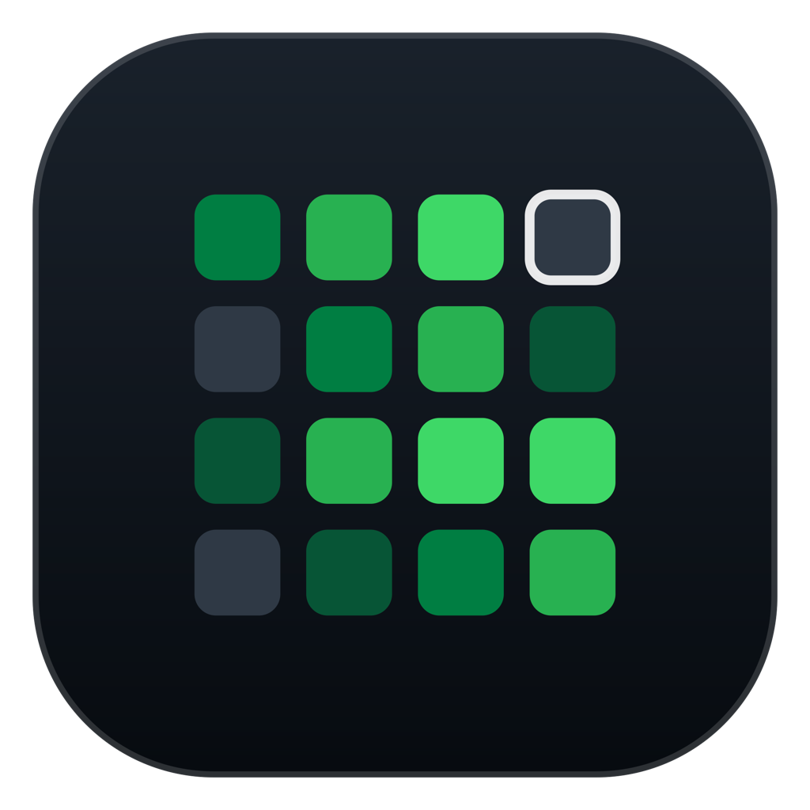
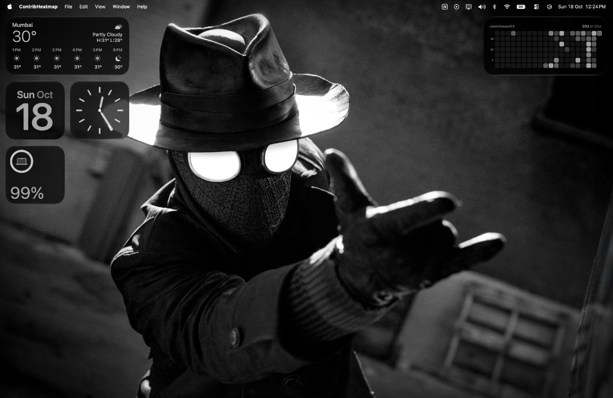
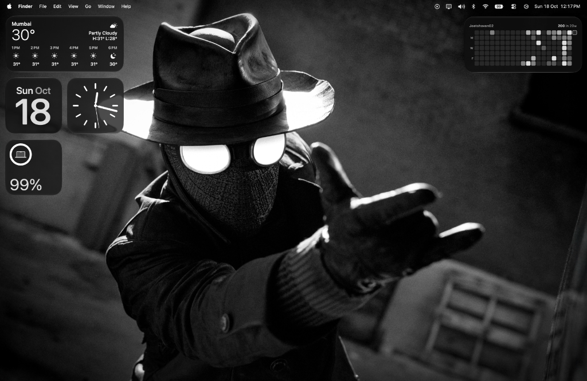
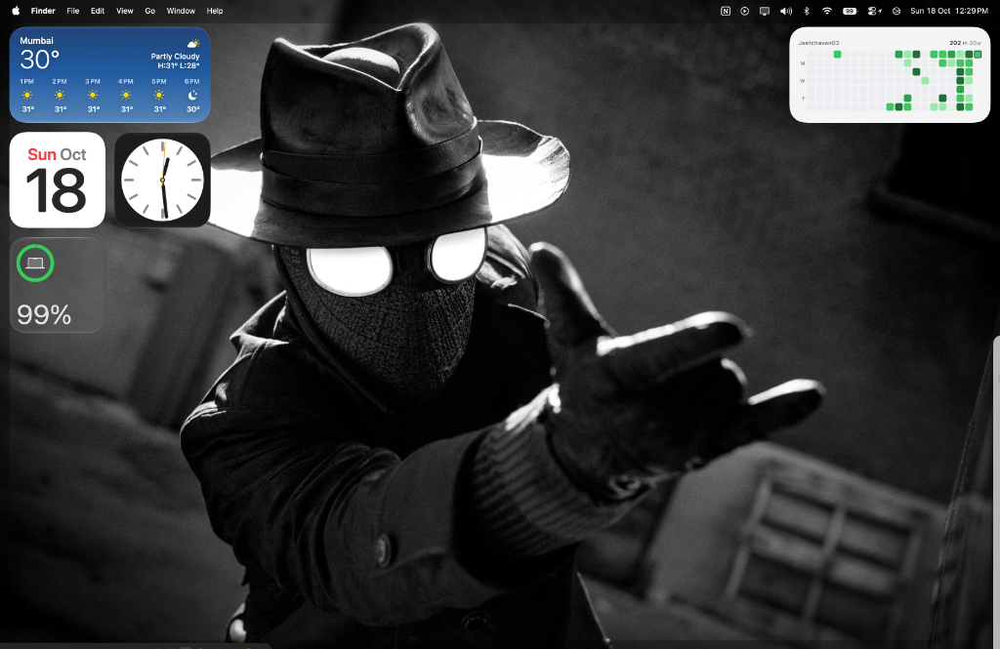
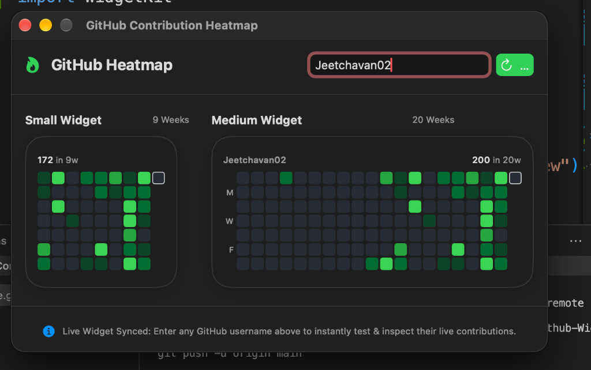
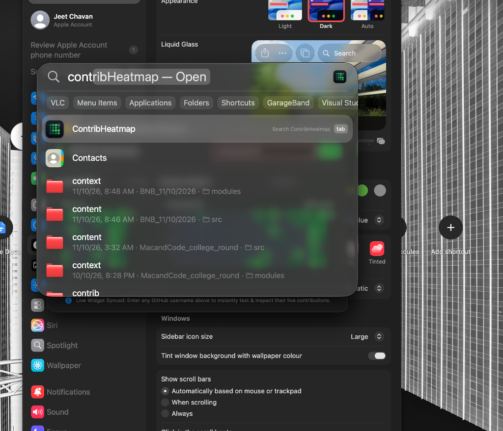

<p align="center">
  
</p>

<h1 align="center">GitHeatmap — GitHub Contribution Heatmap Widget for macOS</h1>

<p align="center">
  <b>v1.0.0 (Production Release)</b><br/>
  A sleek, native macOS desktop & Notification Center widget that brings your real-time GitHub contribution heatmap straight to your Mac.
</p>

<p align="center">
  
  
  
  
  
</p>

---

## 📸 Visual Showcase

### 🌙 Dark Mode Desktop
Crisp GitHub greens (`#0e4429` → `#39d353`) with white border highlight for the current day and bold high-contrast stats.
<p align="center">
  
</p>

---

### 🎨 Monochromatic / Accented Tinted Mode
Seamlessly integrates with your wallpaper theme and macOS Tinted Desktop settings using an intelligent luminance opacity ladder.
<p align="center">
  
</p>

---

### ☀️ Light Mode Desktop
Automatically adapts to soft grey background cells (`#ebedf0`) and rich forest green active cells (`#9be9a8` → `#216e39`).
<p align="center">
  
</p>

---

### 🎛️ Companion Dashboard & Spotlight Search
Test any GitHub user profile in real-time, inspect both Small and Medium widget layouts, and locate the app natively via Spotlight.

<p align="center">
  
  &nbsp;&nbsp;&nbsp;&nbsp;
  
</p>

---

## ✨ Features

- **⚡ Real-Time Live Sync**: Connects to the GitHub contributions API with zero auth friction and instant timeline refresh.
- **🖱️ One-Click Profile Navigation**: Click anywhere on the widget on your desktop or Notification Center to immediately open your profile in your default web browser (`https://github.com/<username>`).
- **🌓 Dynamic Light & Dark Modes**: Fully reactive to system appearance and desktop tint changes using native `.containerBackground(.fill.tertiary, for: .widget)`.
- **📐 Dual Widget Families**:
  - **Medium Widget (`.systemMedium`)**: Displays the last **20 weeks** with weekday indicators (`M`, `W`, `F`) and current day outline.
  - **Small Widget (`.systemSmall`)**: Displays the last **9 weeks** in a compact square.
- **🛡️ Resilient Offline Caching**: Persists recent contribution states to disk via `ContributionCache`; falls back smoothly when offline or traveling.
- **🔒 Swift 6 Concurrency**: Designed with native Swift `actor`, `Sendable`, and zero third-party dependencies.

---

## 🛠️ System Requirements

| Specification | Requirement |
| :--- | :--- |
| **Operating System** | macOS 14.0 (Sonoma) or macOS 15.0+ (Sequoia) |
| **Xcode Version** | Xcode 16.0 or newer |
| **Swift Toolchain** | Swift 6.0+ |
| **Architecture** | Apple Silicon (M1/M2/M3/M4) & Intel (x86_64) Universal |

---

## 📦 Installation & Setup

### Method 1: Download Pre-Built DMG (Recommended)

No Xcode, tools, or dependencies required!

1. Download the latest release: **[ContribHeatmap-v1.0.0.dmg](https://github.com/Jeetchavan02/Macos-Github-Widget/releases/latest)**.
2. Double-click the `.dmg` file to open it, then drag **ContribHeatmap** into your **Applications** folder.
3. Open `ContribHeatmap.app` once from Applications to register the widget extension with macOS.
   > **Note for First Launch:** Because this is an open-source app distributed outside the App Store, macOS Gatekeeper may show a notice:
   > - Right-click (or Control-click) `ContribHeatmap.app` in Applications → click **Open** → click **Open**.
   > - Or run this in Terminal: `xattr -cr /Applications/ContribHeatmap.app`

4. **Add the Widget to Your Desktop**:
   - Right-click anywhere on your macOS desktop and select **Edit Widgets…** (or open the Notification Center).
   - In the widget gallery search bar, search for `ContribHeatmap` or `GitHub`.
   - Choose either the **Small** or **Medium** widget and drag it onto your desktop.
   - Right-click the placed widget and click **Edit "Contrib Heatmap"** to enter your GitHub username.

---

### Method 2: Build & Install via Xcode

If you prefer building from source:

1. **Clone the Repository**:
   ```bash
   git clone https://github.com/Jeetchavan02/Macos-Github-Widget.git
   cd Macos-Github-Widget/ContribHeatmap
   ```

2. **Open the Project**:
   ```bash
   open ContribHeatmap.xcodeproj
   ```

3. **Select Scheme & Build**:
   - In Xcode's toolbar, choose the **`ContribHeatmap`** scheme and destination **`My Mac`**.
   - Press **`Cmd + R`** (or click the Run arrow).
   - The app will compile and launch, registering the widget extension with macOS.

---

### Method 3: Command-Line Build & Run

You can build and run without opening Xcode:

```bash
cd ContribHeatmap
xcodebuild -scheme ContribHeatmap -destination 'platform=macOS' -configuration Release build
open /Users/$(whoami)/Library/Developer/Xcode/DerivedData/ContribHeatmap-*/Build/Products/Release/ContribHeatmap.app
```

---

## 💻 Terminal CLI Tool

Inspect and test any user's heatmap straight in your macOS terminal:

```bash
cd ContribHeatmap
swift run cli-heatmap <github_username> [weeks]
```

Example:
```bash
swift run cli-heatmap Jeetchavan02 20
```

---

## 🧪 Unit Testing

Run the built-in 39-point test suite covering date math, quartile thresholds, and API decoding:

```bash
cd ContribHeatmap
swift run test-runner
```

---

## 📖 Additional Documentation

For architectural design decisions, troubleshooting, and code organization, check out [GUIDANCE.md](GUIDANCE.md).

---

## 📄 License

This project is open source and available under the [MIT License](LICENSE).
